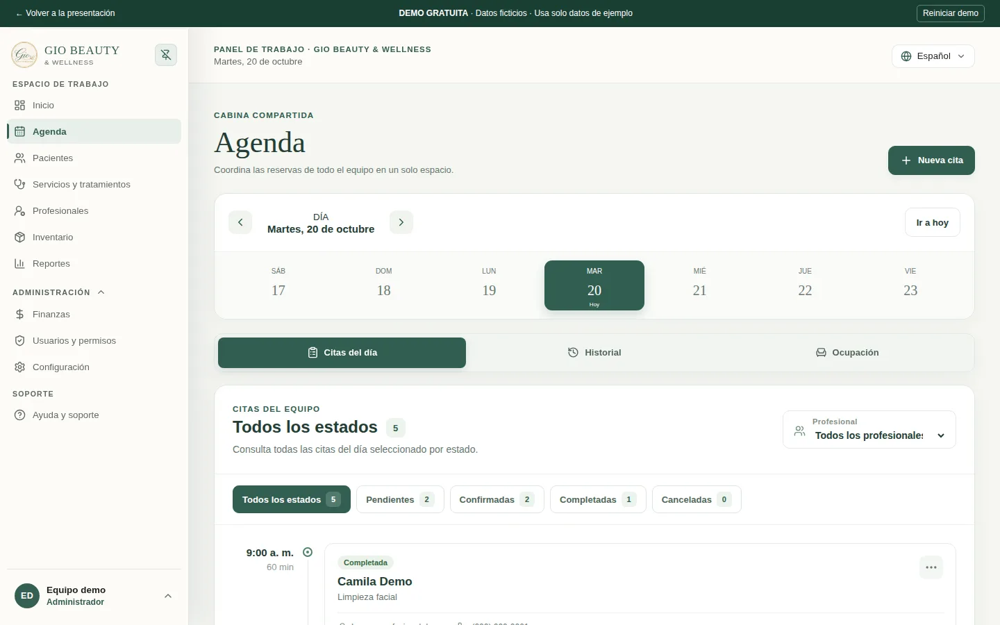
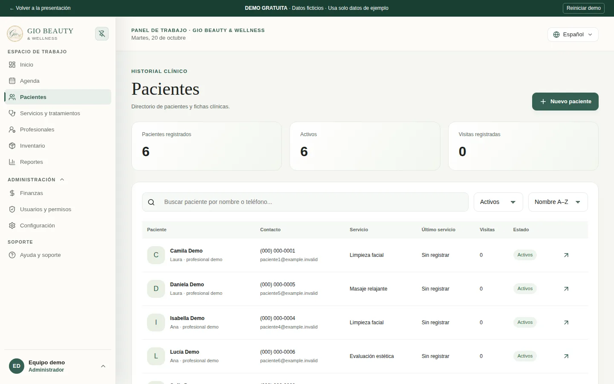
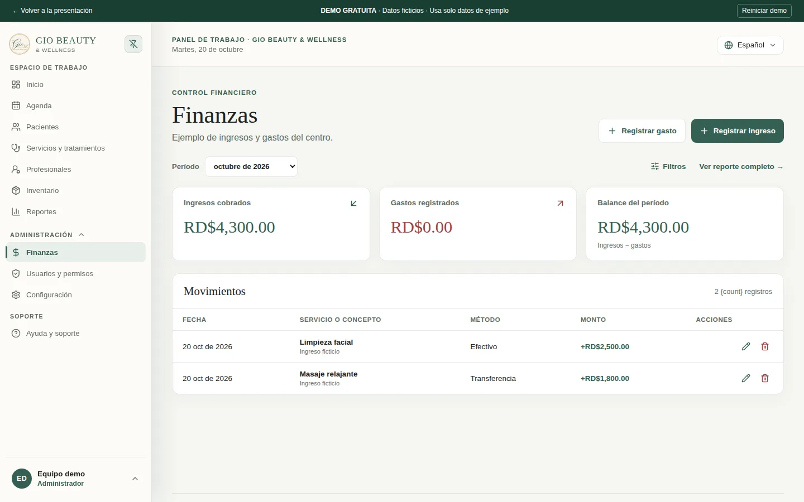

<div align="center">
  
  <h1>GIO Workspace · Demo</h1>
  <p><strong>Your center in order. Your attention where it matters.</strong></p>
  <p>A demo of appointment, patient and finance management for aesthetic and wellness centers.</p>
  <p>
    <a href="https://gio-landing-demo.vercel.app">View the landing page</a> ·
    <a href="https://gio-landing-demo.vercel.app/inicio">Try the demo</a> ·
    <a href="https://gio-landing-demo.vercel.app/marketing/video/gio-demo.mp4">Watch the video</a>
  </p>
</div>



## The problem

Appointments in a chat, patient data in a notebook and payments in a spreadsheet make it hard to see how the center is running. GIO brings all that information into a single workspace to make the work of reception, practitioners and administration easier.

## Explore the product

The demo is free and requires no signup or credit card.

| Module | What you can try |
| --- | --- |
| [Agenda](https://gio-landing-demo.vercel.app/agenda) | View appointments, filter the agenda and add sample appointments. |
| [Patients](https://gio-landing-demo.vercel.app/pacientes) | Search sample patients, open their records and create local entries. |
| [Finances](https://gio-landing-demo.vercel.app/finanzas) | View and record sample income and expenses. |

Changes are saved in your browser. **Reset demo** restores the initial data; the data also refreshes when the day changes. The interface shows other product modules, but some specialized operations are not included in this demonstration.

## Screenshots and video

| Patients | Finances |
| --- | --- |
|  |  |

[](https://gio-landing-demo.vercel.app/marketing/video/gio-demo.mp4)

**[Watch video · 35 seconds](https://gio-landing-demo.vercel.app/marketing/video/gio-demo.mp4)** — a tour of the interface with on-screen text and no narration. The MP4, subtitles and PNG/WebP screenshots are included in `public/marketing/`.

## What this repository contains

This repository contains the **GIO landing page and an isolated demo**. The original application is built with **React, TypeScript and Vite**, with Supabase as the backend.

The interface included here is a **compiled copy** of the published version. `public/demo-adapter.js` replaces backend queries with fictional data and local storage. This repository **does not contain the full TypeScript source code of the product**, nor does it configure a production backend.

| Part | Technology |
| --- | --- |
| Original application | React, TypeScript, Vite |
| Demo interface | Compiled GIO JavaScript/CSS assets |
| Demo data | JavaScript adapter + `localStorage` |
| Commercial landing page | Static HTML, CSS and JavaScript |
| Development server | Node.js, no external dependencies |
| Recording and export | Playwright and FFmpeg, optional |
| Hosting | Vercel |

Use sample information only. The demo is not an installation for caring for real patients. See [scope and provenance](docs/DEMO.md).

## Run locally

You need **Node.js 22 or higher**.

```bash
git clone https://github.com/eduardolluis/gio-workspace-demo.git
cd gio-workspace-demo
npm run dev
```

Open **http://localhost:3000**. You don't need to run `npm install` or set up any keys to explore the landing page and the demo.

```bash
npm run check
```

This command checks the syntax of the editable files. It does not replace a visual or functional review.

## Structure

| Path | Contents |
| --- | --- |
| `public/index.html` | Landing page and links to the demo. |
| `public/demo.html` | Entry point of the demo application. |
| `public/demo-adapter.js` | Fictional data, local queries and persistence. |
| `public/demo.css` | Demo banner and interface adjustments. |
| `public/assets/` | Compiled assets of the original application. |
| `public/icons/` and `public/images/` | Branding and graphic assets. |
| `public/marketing/` | Styles, gallery, contact settings, screenshots and video. |
| `scripts/` | Local server, recording and media export. |
| `docs/` | Demo scope, deployment, checks and video script. |
| `vercel.json` | Public directory, demo routes and headers. |

The compiled assets in `public/assets/` are kept as a snapshot of the product. To modify React components or build new features, you need the original source repository.

## Customization and deployment

- **Text:** `public/index.html`.
- **Design:** `public/marketing/styles.css`.
- **Contact:** `public/marketing/config.json` and the `data-contact` links on the landing page.
- **Sample data:** `public/demo-adapter.js`.
- **Sale listing badge:** `.sideprojectors-badge` link on the home page. Its destination is external; whether the listing is visible depends on SideProjectors.

To deploy on Vercel, import the repository with **Framework: Other**, no install or build commands, and **Output Directory: `public`**. The `vercel.json` file includes this configuration. See the [deployment guide](docs/DEPLOYMENT.md).

## Regenerate the video

The media files are already included. Only if you want to record them again do you need FFmpeg and the development dependencies:

```bash
npm ci
npx playwright install chromium
npm run dev
```

In another terminal:

```bash
npm run demo:record
npm run demo:export
```

`GIO_DEMO_URL` lets you change the demo address and `GIO_OUTPUT` the output directory. Raw recordings are excluded from Git. Review the [video script](docs/GUION_VIDEO.md) before exporting again.

## Author and commercial use

Developed by **[Eduardo Luis De La Cruz](https://github.com/eduardolluis)**.

For questions about the product, customization or acquisition: [contact the developer](https://portfolio-one-blue-anckqnppbh.vercel.app/).

This repository is public to showcase the project. **All rights reserved**; publishing it does not grant a license to reuse or commercialize it. See [LICENSE](LICENSE). Third-party dependencies retain their own licenses.
